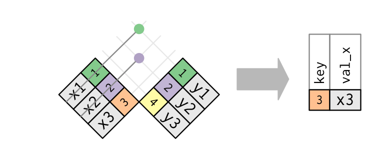

Question
========
Eine häufige Aufgabe in der Analyse von Daten (großer und kleiner Bestände) ist das Zusammenfügen von Tabellen. Ein typisches Beispiel ist das Zusammenfügen zweier Tabellen, wo in einer Kundentransaktionen und in einer zweiten die Adressdaten der Kunden stehen.


Das Diagramm stellt einen Antijoin dar.

```{r echo = FALSE, results = "show", fig.height = 3.5, fig.width = 5.8, fig.path = "", fig.cap = ""}
pathToImages <- paste0(here::here(),"/img/")


```


Im Textmining werden Antijoins z.B. verwendet, um Stopwörter zu extrahieren. Welche Aussage dazu ist korrekt?

Answerlist
----------
* Die Funktion `anti_join()` vereinigt zwei Vektoren bzw. nimmt Vektoren als Input.
* Es bleiben nur die Zeilen übrig, welche in beiden Tabellen vorkommen.
* Es bleiben nur die Spalten übrig, welche in beiden Tabellen vorkommen.
* Es bleiben nur die Zeilen übrig, die in *keiner* der beiden Tabellen vorkommen.
* Es bleiben nur die Spalten übrig, die in *keiner* der beiden Tabellen vorkommen.


Solution
========

D: Es bleiben nur die Zeilen übrig, die in *keiner* der beiden Tabellen vorkommen.


Aufgabenname: `antijoin`


Meta-information
================
extype: schoice
exsolution:  00010
exname: antijoin


