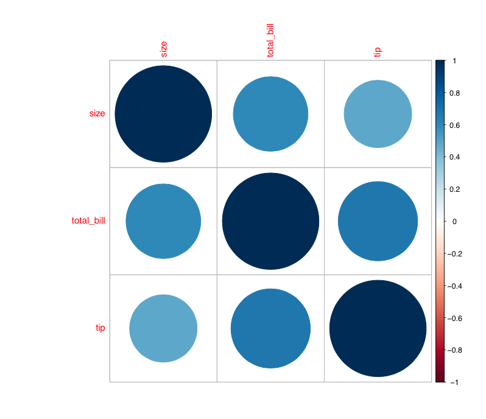

Question
========
Welche Aussage zum Korrelationsdiagramm ist korrekt?


```{r pca1, echo = FALSE, message = FALSE, fig.cap = "Streuung" }
library(here)
pathToImages <- paste0(here::here(),"/img/")

```


Answerlist
----------
* Es gibt nur positive Korrelationen.
* Die Korrelation von `size` mit sich selbst ist ungleich Eins.
* Auf der Hauptdiagonalen werden die Korrelation von `size` mit den anderen Variablen dargestellt.
* Die Korrelation von `size` mit `tip` ist die stärkste.

Solution
========

C: Die zweite Hauptkomponente ist unkorreliert zur ersten – und beinhaltet weniger Variation. Sie steht senkrecht zur ersten, und dort streuen die Daten weniger.


Aufgabenname: `corrplot`


Meta-information
================
extype: schoice
expoints: 1
exsolution:  1000
exname: corrplot

