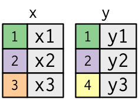
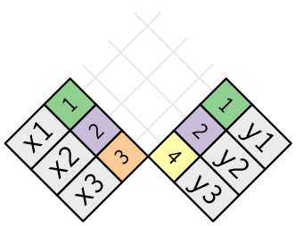

```{r libs, include = FALSE}
library(tidyverse)
library(exams)
```


```{r global-knitr-options, include=FALSE}
knitr::opts_chunk$set(fig.pos = 'H',
                      fig.asp = 0.618,
                      out.width = "50%",
                      fig.width = 4,
                      fig.cap = "", 
                      fig.path = "",
                      echo = FALSE,
                      message = FALSE,
                      fig.show = "hold")

```


Question
========

In komplexeren Datenszenarien sind Daten über mehrere Tabellen verteilt. 
Ein typisches Beispiel sind Daten von Kundentransaktionen:
So kann Tabelle 1 die Stammdaten des Kunden beinhalten (wie Kunden-ID, Name, Adresse);
Tabelle 2 enthält die Transaktionsdaten von Kunden (wie Datum, Betrag, Kunden-ID).
Über eine gemeinsame ID-Variable (auch Key genannt) können dann 
die über mehrere Datensätze verteilten Datensätze "eingesammelt" ("verheiratet") werden.

Die gebräuchlichste Methode dazu nennt man meist "Joins".

Im Buch [R for Data Science ](https://r4ds.had.co.nz/relational-data.html#introduction-7) von Hadley Wickham steht dazu als Erklärung Folgendes:

>    It’s rare that a data analysis involves only a single table of data. Typically you have many tables of data, and you must combine them to answer the questions that you’re interested in. Collectively, multiple tables of data are called relational data because it is the relations, not just the individual datasets, that are important.

>    Relations are always defined between a pair of tables. All other relations are built up from this simple idea: the relations of three or more tables are always a property of the relations between each pair. Sometimes both elements of a pair can be the same table! This is needed if, for example, you have a table of people, and each person has a reference to their parents.


```{r results = "hide"}
join_types <-
  c("join-anti",
    "join-full",
    "join-inner",
    "join-left",
    "join-right",
    "join-semi")

join_outer_full <- "join-outer-full"

join_setup <- 
  c("join-setup",
    "join-setup2")

include_supplement(file = paste0(c(join_types, join_setup, join_outer_full), ".png"),
                   recursive = TRUE)
```


```{r}
join_correct <- sample(join_types[1:4], size = 1)
joins_chosen_incorrect <- sample(join_types[join_types != join_correct], 4)

joins_df <-
  tibble(
    id = 1:5,
    joins = c(join_correct, joins_chosen_incorrect),
    join_file = paste0(joins, ".png"),
    is_correct = c(T, F, F, F, F)
  ) %>% 
  sample_n(size = nrow(.)) %>% 
  mutate(id2 = row_number(),
         id3 = paste0("Diagramm ", LETTERS[id2]))
```


Hier ist eine Visualisierung zweier Tabellen (x,y),
mit gemeinsamen Datensätzen.
So finden sich etwa zu Datensatz/Beobachtung `1` in Tabelle `x` die Variable `x` 
mit dem Wert `x1` und in Tabelle `y` die Spalte `y` mit dem Wert `y1`, etc.

```{r}

```

Ein Join ist eine Methode, jede Zeile aus der Tabelle `x` 
mit keiner, einer oder mehreren Zeilen aus der Tabelle `y` zu vereinigen (zusammmenzuführen).

Das folgende Diagramm zeigt jedes (potenzielle) Zusammenführen als Schnittpunkt zweier Linien.


```{r}

```


**Betrachten Sie die folgenden Diagramme,**
**sie stellen verschiedenen Arten von Joins dar.**

**Welches Diagramm zeigt einen `r join_correct`?**

Diagramm A:

```{r}
knitr::include_graphics(joins_df$join_file[1])
```

Diagramm B:

```{r}
knitr::include_graphics(joins_df$join_file[2])
```

Diagramm C:

```{r}
knitr::include_graphics(joins_df$join_file[3])
```

Diagramm D:

```{r}
knitr::include_graphics(joins_df$join_file[4])
```

Diagramm E:

```{r}
knitr::include_graphics(joins_df$join_file[5])
```


Wählen Sie die korrekte Aussage aus!


```{r itemlist, results="asis"}
answerlist(joins_df$id3, markup = "markdown")
```


Solution
========

Weiterführende Informationen zu Joins finden sich z.B. [hier](https://r4ds.had.co.nz/relational-data.html#relational-data).


Aufgabenname: `joins`


```{r itemlist_answer, results="asis"}
answerlist(ifelse(joins_df$is_correct, "Wahr", "Falsch"), 
           joins_df$joins,
           markup = "markdown")
```

  
  

Meta-information
================
exname: joins
extype: schoice
exsolution: `r mchoice2string(joins_df$is_correct, single = TRUE)`
exshuffle: false
